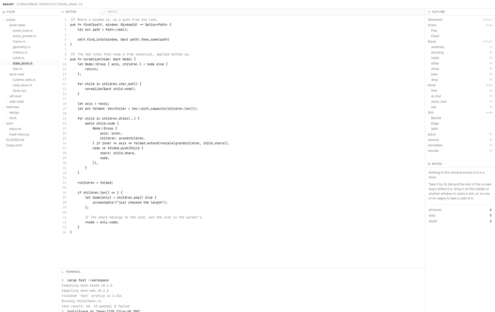

# weaver

A tiled dock: windows on a surface that you arrange by dragging their tabs
and resize by the lines between them, and that stay where you put them.



It is a library, not a program. It decides where the rectangles go and draws
a window's tab, the lines, and the two things that exist only while a window
is being carried. Everything inside a window is the program's — the file
tree, the code, the test run and the terminal above are the demo's own, and
the dock has never heard of any of them.

## What it does

**Windows are tiled and never overlap.** There is no z-order and no window
lost behind another. A window you put somewhere stays there, at the size you
left it, until you move it again.

**A window is moved by its tab.** The whole tab is the handle, so there is
nothing to aim at inside one, and pressing it brings its window forward. What
follows the cursor is that tab and not a small copy of the window, which is
already on screen behind it.

**Where a drop lands is shown rather than guessed.** The body of a window is
cut into four bands and a middle — all five are drawn while something is
being carried, with the one under the pointer darker. A band takes a side of
the window; the middle joins its slot; a slot's tabs set the order within it;
and the strip along the dock's own edge takes a whole side of everything.

**Windows can share a slot.** Several in one place wear a tab each, because a
dock that can only tile runs out of room — six windows on a laptop screen is
six windows too narrow to use.

**A line between two windows is the control that resizes them.** It is one
pixel wide and reaches a few more into the windows either side, so what you
take hold of is wider than what you see. Where two lines cross, both move at
once.

Sizes are either a weight or a number of pixels: a column of readouts should
be the width it needs rather than a share of whatever the screen happens to
be, and a sidebar somebody dragged to 300px is still 300px after the browser
is resized.

## Using it

A host opens windows, says where each one goes and how it takes its space,
and draws whatever it likes inside them.

```rust
use dock_state::{Event, EventHost, Share, Side, Slot, WindowId};
use dock_web::{Dock, DockView};
use leptos::prelude::*;

const EDITOR: WindowId = WindowId(1);
const TESTS: WindowId = WindowId(2);
const TERMINAL: WindowId = WindowId(3);

let dock = Dock::new();

// The first window is the whole dock; every one after it says where it goes
// relative to one already open.
open(dock, EDITOR, "editor", Slot::Edge { side: Side::Right }, Share::Flex(1.0));
open(dock, TESTS, "tests", Slot::With { window: EDITOR, before: false }, Share::Flex(1.0));
open(dock, TERMINAL, "terminal", Slot::Beside { window: EDITOR, side: Side::Down }, Share::Fixed(168.0));

view! { <DockView dock=dock content=content icon=icon /> }

fn open(dock: Dock, window: WindowId, title: &str, at: Slot, share: Share) {
    dock.send(Event::FromHost(EventHost::Opened {
        window,
        title: title.to_string(),
        at,
        share,
    }));
}
```

`content` is called once per window, not once per frame, and a window behind
a tab is hidden rather than taken down — so leafing through a stack costs the
host nothing. `icon` is optional and draws before a tab's name; nothing is
drawn when there is none.

The look is a stylesheet of roles — `--panel`, `--border`, `--accent`,
`--tab`, `--gap` — and not part of the library. What the demo wears is
borrowed from `hl`, a sibling project: black on white, black as the accent,
and red kept for the one thing red is for.

## How it is built

The dock is a state machine. Events go in, actions come back once the whole
batch has landed, and everything drawn is derived on the way out:

```rust
dock.handle_events(&events);
dock.emit_actions(&mut actions);

let frame = dock.frame();
```

Nothing in it reads a clock, and nothing in it knows what a browser is. The
browser hands over a whole frame's worth of pointer moves at once, so the
dock answers a burst of them as one situation and lays out once a frame
because of how it is called rather than because something debounces it.

Nothing derived is stored. No rectangle is cached, and neither is the drop
the pointer is over: it is worked out on the way out, which is why the region
drawn under the cursor and the drop that happens cannot be about different
things. Hit testing is the machine's too — which tab or line a press landed
on is a question about rectangles, and the rectangles are its.

```
dock-state   the dock: the tree, the solve, the gestures. No IO, no browser
dock-web     the dock in a browser: a frame loop, one pointer listener
web-main     the page in the clip above
```

`dock-web` decides nothing — it forwards pointer positions and moves elements
to the rectangles the frame names. A native backend is the same file against
a different screen, and GPUI is the one intended for it.

## Running it

```
cargo test --workspace
cd crates/web-main && trunk serve      # http://127.0.0.1:7150
```

The tests are written through [`eval!`][eval], the macro every state machine
here is tested with: a slice of events in, the actions they must produce out.
It lives next door rather than in this repo, so a clone of this one alone
cannot run them yet.

[eval]: https://github.com/llGaetanll/eval

`sketches/dock/index.html` draws every state the dock can be in, each with
the argument for it and with what has not been decided marked as such. It is
where a change to how the dock behaves is argued about before it is built.

`tools/trace.sh` makes the page perform a gesture and writes down where every
slot, tab and line was on each animation frame; `tools/read-trace.py` says
what moved, when, and along what curve. `tools/clip.py` makes the film at the
top of this page.

## What is not there yet

- **Nothing is written down.** A layout is lost on reload. The machine has no
  actions at all yet, which is the honest shape of that: a dock has nothing
  to ask of the world until it has somewhere to keep what it arranged.
- **No keyboard.** Moving and resizing are gestures; only escape is bound,
  and it abandons one.
- **Windows do not settle into place.** When the layout changes they are
  simply there. A window arriving has nothing to move *from*, and half an
  answer looked worse than none.
- **One minimum for every window**, rather than each saying its own.
- **The web only.** Nothing above `dock-state` is native yet.
